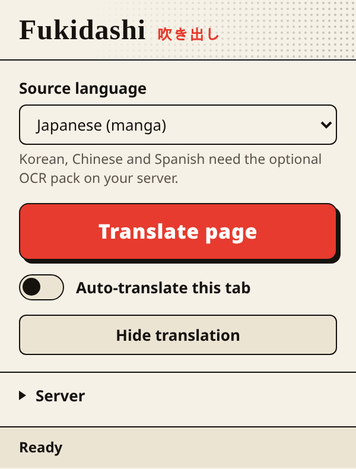
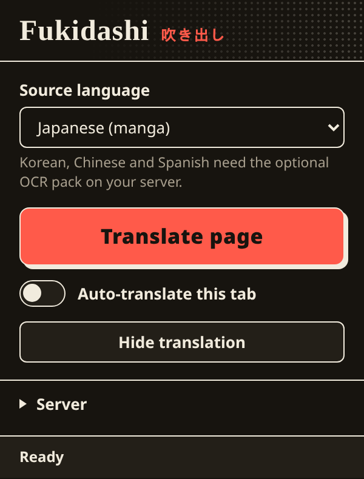

<picture>
  <source media="(max-width: 700px)" srcset="docs/readme/header-mobile.svg">
  
</picture>

**Fukidashi** (吹き出し, *speech bubble*) translates raw manga in your browser, on the site you are already reading. It is a Chrome extension backed by a small Python server on your own GPU. Click **Translate** and the extension captures the visible page. The server finds every speech bubble, reads the Japanese and translates the whole page in one pass. The English is then drawn over each bubble and scrolls with the page.

No uploads to a third-party app, and no downloading chapters first. It works on any site, because it only looks at what is on your screen.

## How it works

```
 Chrome tab                       Fukidashi server (FastAPI, your GPU)
 ──────────                       ─────────────────────────────────────
 popup / Alt+Shift+T
   │
 service worker ── screenshot ──▶ 1. DETECT     RT-DETR (ogkalu/comic-text-and-bubble-detector)
   │                                            bubbles, text in bubbles, free text
   │                              2. READ       manga-ocr for Japanese, PaddleOCR for the rest
   │                              3. TRANSLATE  Gemini: the whole page in one call, in reading order
   │                                            Google Translate as a fallback
 content script ◀── boxes + text ─┘
   draws English over each bubble, inside the page's scroll container
```

- **Detection** uses all three classes of the detector: the bubble outline, the text inside it, and free text outside bubbles. Text is read from the tight text box, and the English is drawn over the whole bubble so it covers the original cleanly. Duplicate boxes are merged, and lines are sorted in manga reading order (right to left, top to bottom).
- **Translation is page-aware.** With a Gemini key, every line on the page goes into one request, in reading order, so names, pronouns and tone carry across bubbles. The model must return exactly one line per bubble. If that fails, or there is no key, each line goes to Google Translate in parallel.
- **The models load once and stay on the GPU.** Each page is inference only, and requests are serialised, so two tabs never fight over GPU memory.
- **The overlay follows the page.** It is attached to the page's real scroll container, so translated bubbles scroll with the art. Re-translating hides the old overlay before capturing, so the server never reads its own English.

## The extension

<p align="center">
  
  &nbsp;&nbsp;
  
</p>

- **Translate page** (or <kbd>Alt</kbd>+<kbd>Shift</kbd>+<kbd>T</kbd>) translates what is on screen.
- **Auto-translate this tab** translates again each time the tab loads a new page, so you can read a chapter by just clicking *next*.
- **Hide translation** (or <kbd>Alt</kbd>+<kbd>Shift</kbd>+<kbd>H</kbd>) toggles the overlay to compare against the original art.
- **Server** settings take any URL: `http://127.0.0.1:8000` by default, or an ngrok tunnel to a GPU machine elsewhere. *Test connection* checks `/health`.
- **Source languages:** Japanese (manga) out of the box. Korean (manhwa), Chinese (manhua) and Spanish need the optional OCR pack on the server.

## Run it

You need Python 3.10+ and, for real-time speed, an NVIDIA GPU. It runs on CPU and Apple Silicon (MPS), only slower.

```bash
git clone https://github.com/ashis05/fukidashi.git
cd fukidashi/backend
python -m venv .venv && source .venv/bin/activate   # Windows: .venv\Scripts\activate

# NVIDIA GPU: install the CUDA build of PyTorch first
pip install torch torchvision --index-url https://download.pytorch.org/whl/cu124
pip install -r requirements.txt
pip install -r requirements-paddle.txt   # optional: Korean, Chinese, Spanish, ...

cp .env.example .env    # optional: add GEMINI_API_KEY for page-aware translation
python -m fukidashi serve
```

The first request downloads the models from Hugging Face (several hundred MB) and loads them; set `WARMUP=1` to do that at startup instead. Then load the extension:

1. Open `chrome://extensions` and turn on **Developer mode**.
2. Click **Load unpacked** and choose the `frontend/` folder.
3. Open a manga page, click the Fukidashi icon, and press **Translate page**.

### Translate files without a browser

The same pipeline works as a batch tool. It renders the English into copies of the pages:

```bash
python -m fukidashi translate chapter-12/ -o out/ --lang ja
```

### Configuration

All settings are environment variables (or `backend/.env`):

| Variable | Default | |
|---|---|---|
| `GEMINI_API_KEY` | none | Enables page-aware Gemini translation. Without it, Google Translate is used. |
| `GEMINI_MODEL` | `gemini-2.5-flash-lite` | Any Gemini model that returns JSON. |
| `TRANSLATOR` | `gemini` if a key is set, else `google` | Force one backend. |
| `HOST` / `PORT` | `127.0.0.1` / `8000` | Bind address. Keep it local, or use a tunnel. |
| `DETECT_THRESHOLD` | `0.4` | Detector confidence cut-off. Lower it if bubbles are missed. |
| `MAX_UPLOAD_MB` | `10` | Larger uploads are rejected with 413. |
| `RATE_LIMIT` | `30/minute` | Per client IP. `0/minute` turns it off. |
| `ALLOWED_ORIGINS` | none | Extra CORS origins. `chrome-extension://` origins are always allowed. |
| `WARMUP` | `0` | `1` loads the models at startup. |
| `FUKIDASHI_FONT` | auto | TTF/OTF used by the batch renderer. |

### API

`POST /translate` takes multipart `file` (JPEG, PNG or WebP) and `source_lang` (`ja`, `ko`, `zh`, `es`, `en`, `fr`, `de`, `it`, `pt`, `ru`):

```json
{
  "data": [
    { "box": [412, 96, 588, 301], "text": "I have to read what happens next!", "source": "続きが読みたい！", "kind": "text_bubble" }
  ],
  "width": 1280, "height": 720, "elapsed_ms": 412, "translator": "gemini"
}
```

Boxes are in the uploaded image's pixels, in reading order. Errors come back as `{"detail": "..."}` with 400 (bad image or language), 413 (too large), 429 (rate limited) or 501 (OCR pack not installed). `GET /health` reports the device, which models are loaded, and the active translator.

## Development

```bash
cd backend
pip install -r requirements-dev.txt
pytest
```

The tests cover the HTTP contract, box merging and reading order, bubble pairing, translator fallback and the renderer. They use fake models, so they run in about a second without PyTorch or a GPU. The extension has no build step: edit `frontend/` and press reload in `chrome://extensions`.

```
backend/fukidashi/   config, detector, ocr, translate, pipeline, render, server, cli
backend/tests/       pytest suite (fakes, no GPU)
frontend/            Manifest V3 extension: background.js, content.js, popup.*
docs/readme/         make_svg.py draws the header above
```

## Limits

- Only what is on screen is translated: one capture per screen. Scroll, then translate again (auto mode handles page changes, not scrolling).
- The English covers the bubble; it does not redraw the art underneath, so text written over artwork gets a white box.
- Sound effects drawn as art are usually not detected.
- Machine translation is good for following a story, not a replacement for a human scanlation.

## License

[MIT](LICENSE) © 2026 Ashis Wadhwani
